# 2. Data model and key API endpoints

The reference DDL is [`schema/schema.sql`](../schema/schema.sql) (PostgreSQL 16). [`schema/schema_test.sql`](../schema/schema_test.sql) exercises the evidence gate, the audit chain, row-level security and deletion; run it against a throwaway database (see the end of this document).

## 2.1 Entity overview

```mermaid
erDiagram
  users ||--o| user_profiles : has
  users ||--o| user_keys : "encrypted by"
  users ||--o{ consents : grants
  users ||--o{ body_measurements : records
  users ||--o{ food_log_entries : logs
  food_items ||--o{ food_log_entries : "logged as"
  food_items ||--o{ health_ratings : "rated by"
  users ||--o{ ingredient_scans : captures
  ingredient_scans |o--o| food_items : "confirmed into"
  users ||--o{ nutrition_targets : has
  users ||--o{ workout_splits : owns
  workout_splits ||--|{ split_versions : "versioned as"
  split_versions ||--o{ split_reviews : "reviewed in"
  users ||--o{ workout_sessions : performs
  workout_sessions ||--o{ set_logs : contains
  exercises ||--o{ exercise_muscles : credits
  muscles ||--o{ exercise_muscles : "credited by"
  users ||--o{ check_ins : answers
  users ||--o{ recommendations : receives
  recommendations ||--o{ recommendation_evidence : "cites, frozen"
  recommendations |o--o{ split_versions : "accepted as"
  recommendations |o--o{ nutrition_targets : "accepted as"
  recommendations ||--o{ evidence_alerts : "flagged by"
  claims ||--o{ claim_sources : "supported by"
  sources ||--o{ claim_sources : supports
  sources ||--o{ source_checks : "verified by"
  verification_runs ||--o{ source_checks : contains
  users ||--o{ wearable_connections : connects
  wearable_connections ||--o{ sync_cursors : tracks
  users ||--o{ wearable_daily_metrics : "measured by"
  users ||--o{ wearable_workouts : records
  users ||--o{ readiness_snapshots : "scored in"
```



## 2.2 Table groups

| Group | Tables | Notes |
|---|---|---|
| Identity and privacy | `users`, `user_keys`, `user_profiles`, `consents`, `body_measurements`, `privacy_requests` | `user_keys` holds the KMS-wrapped data key for that user's `*_enc` columns; deleting it is crypto-shredding. `consents` has one row per grant per purpose, so consent history is auditable. `user_profiles.safety_flags` drives the hard safety rules, and nothing is suggested while `user_profiles.safety_answered_at` is NULL (the questions come after sign-up). |
| Food catalogue (shared) | `food_items`, `barcode_lookups`, `health_ratings` | `gtin14` is the normalised barcode. `nutrients_per_100` uses canonical keys and units. `owner_user_id` marks private items (custom foods, confirmed scans). Health ratings are versioned by ruleset. |
| Food logging | `ingredient_scans`, `food_log_entries`, view `daily_nutrition`, `nutrition_targets` | Log entries snapshot the nutrients at log time and carry `estimate_confidence`, so the dashboard can say "2 of today's entries are estimates". `client_entry_id` makes offline sync idempotent. |
| Training | `muscles`, `exercises`, `exercise_muscles`, `workout_splits`, `split_versions`, `split_reviews`, `workout_sessions`, `set_logs`, `check_ins` | Split versions are immutable snapshots with `diff_from_parent` and `weekly_volume`. `exercise_muscles.set_credit` gives fractional set counting (e.g. 1.0 primary, 0.5 secondary). Reviews hold *descriptive* findings only. |
| Evidence (shared) | `claims`, `sources`, `claim_sources`, `verification_runs`, `source_checks` | A claim is a reviewed statement the engine relies on. `claim_sources` stores the finding, limitations and a verbatim supporting quote per source. `source_checks` is append-only: one row per check, per source, per run. |
| Recommendations | `recommendations`, `recommendation_evidence`, `evidence_alerts` | `claim_ids` names every claim a change relies on. `recommendation_evidence` freezes the exact citations shown. `evidence_alerts` records later retractions affecting accepted changes. |
| Wearables | `wearable_connections`, `sync_cursors`, `wearable_daily_metrics` (partitioned), `wearable_workouts`, `readiness_snapshots`, `webhook_inbox` | `data_types_enabled` is the user's sharing choice. `token_version` is the optimistic lock for refresh-token rotation. HRV is stored as `hrv_rmssd_ms` or `hrv_sdnn_ms`, never merged. |
| Audit | `audit_events` | Append-only, and hash-chained by a trigger. Payloads hold IDs, statuses and versions, never health values, so the log can be kept after an account is deleted. |

### Invariants the database enforces

These are tested in `schema_test.sql`.

1. A recommendation cannot be `proposed` or `accepted` unless:
   * it names at least one claim,
   * every named claim is `active`, and
   * every named claim has at least `min_sources_required` verified sources in `recommendation_evidence`.

   `min_sources_required` cannot be set below 3.
2. A split version or nutrition target with `origin = 'app_recommendation'` must reference an `accepted` recommendation of the matching kind for the same user. User edits (`origin = 'user_edit'`) need none.
3. `split_versions`, `source_checks`, frozen `recommendation_evidence` rows and `audit_events` cannot be updated. `audit_events` cannot be deleted either.
4. An `active` claim must have a named reviewer and a review date.
5. Row-level security restricts every user-owned table to `app.current_user_id`, which the API sets per transaction. Shared catalogue rows are readable by everyone; private food items only by their owner. The API connects as a non-owner role; workers that act across users use a separate role with `BYPASSRLS`, and their access is audited.
6. Deleting a user cascades to all of their rows. The shared library and the pseudonymous audit log remain.

### Canonical nutrient keys

`energy_kcal`, `protein_g`, `carbohydrate_g`, `sugars_g`, `fat_g`, `saturated_fat_g`, `fiber_g`, `sodium_mg`, `salt_g` (derived as sodium × 2.5), plus optional `added_sugars_g`, `trans_fat_g`, `potassium_mg`. All values are per 100 g, or per 100 ml when `is_beverage`. Source-specific keys (Open Food Facts `nutriments`, FDC nutrient numbers) are mapped in `packages/domain/nutrients.ts`, and unmapped values are kept in an `extra` object rather than dropped.

## 2.3 API conventions

* REST + JSON under `/v1`, described by an OpenAPI document generated from the zod contracts.
* `Authorization: Bearer <Cognito access token>`; the API derives the user ID itself and never accepts one from the client.
* `Idempotency-Key` header on every POST that creates data (food logs, scans, HealthKit batches, change requests).
* Cursor pagination (`?cursor=&limit=`). Errors use `application/problem+json` (RFC 9457) with a stable `type` URI.
* Dates in the user's local calendar use `YYYY-MM-DD` (`local_date`); instants are RFC 3339 UTC.
* Every response that includes a recommendation also includes `disclaimer` (versioned text) and `evidence`.

## 2.4 Endpoints

### Profile, consent, privacy

| Method & path | Purpose |
|---|---|
| `GET /v1/me` · `PATCH /v1/me/profile` | Profile, goal, experience, equipment, schedule. Writing health notes or safety flags is audited. |
| `GET /v1/me/consents` · `POST /v1/me/consents` · `DELETE /v1/me/consents/{purpose}` | Grant or revoke per purpose. Revoking `wearable:*` pauses that provider; revoking `ai_processing` switches off LLM-backed features. |
| `POST /v1/onboarding/complete` | Marks sign-up done after the required steps: disclaimer, account, health-data consent, age gate, weight and goal. Everything else is set up later from the app's tabs. |
| `POST /v1/me/exports` · `GET /v1/me/exports/{id}` | Starts an export job, then returns a signed URL (7-day expiry) to a ZIP of JSON + CSV covering everything, including recommendations with their frozen citations. |
| `DELETE /v1/me` | Schedules deletion (7-day grace period, cancellable), then revokes provider tokens, deletes rows, destroys the data key and issues a deletion receipt. |
| `GET /v1/me/access-log` | Recent access to the user's data by system and staff actors (from `audit_events`). |

### Food

| Method & path | Purpose |
|---|---|
| `GET /v1/foods/barcode/{gtin}` | Lookup chain: mirror/cache → Open Food Facts → FDC. Returns `found`, `pending` (202) or `not_found` (404, with `fallback: "ingredient_scan"`). The app sends the GTIN-14 it read from a linear barcode, a GS1 Digital Link QR code or a GS1 element string; it never sends a QR code's full contents. |
| `GET /v1/foods/search?q=` | Text search across the shared catalogue and the user's private foods. |
| `GET /v1/foods/{id}` · `GET /v1/foods/{id}/health-rating` | Food detail and the explained rating. |
| `POST /v1/foods/custom` | User-defined food. |
| `POST /v1/ingredient-scans` | Body: OCR text and boxes from the device, or uploaded image keys if the user allowed upload. Returns the scan with parse, estimate, rating, confidence and reasons. |
| `PATCH /v1/ingredient-scans/{id}` | User corrections to ingredients or values; re-validates and re-scores. |
| `POST /v1/ingredient-scans/{id}/confirm` | Creates the private `food_items` row. Optional `contributeToOpenFoodFacts: true` (needs consent). |
| `POST /v1/food-logs` · `PATCH/DELETE /v1/food-logs/{id}` · `GET /v1/food-logs?date=` | Logging. Offline entries sync with `client_entry_id`. |
| `GET /v1/nutrition/daily?from=&to=` | Totals per day vs target, plus counts of estimated entries. |
| `GET /v1/nutrition/targets` · `PUT /v1/nutrition/targets` | Current and historical targets. `PUT` is the user's own edit (`origin = user_edit`). |
| `POST /v1/nutrition/targets/recommendations` | Ask the app to suggest targets. Goes through the evidence gate (Phase 3+). |

### Training

| Method & path | Purpose |
|---|---|
| `GET /v1/exercises?muscle=&equipment=&modality=` | Exercise catalogue with muscle credits. |
| `POST /v1/splits` · `GET /v1/splits/{id}` | Create a split (version 1) or read it, including the current version and weekly volume. |
| `POST /v1/splits/{id}/versions` | The user's own explicit edit. Creates a new version with `origin = user_edit` and returns the diff plus any new descriptive findings. |
| `GET /v1/splits/{id}/versions` · `GET /v1/splits/{id}/versions/{v}/diff?against={v0}` | Version history and structured diffs. |
| `POST /v1/splits/{id}/reviews` | Runs the analyser and returns findings: volume per muscle, imbalances, missing rest, overlaps, goal mismatch. |
| `POST /v1/splits/{id}/change-requests` | Body: free text and/or a structured intent (`develop_muscle`, `switch_style`, `add_exercise`, `remove_exercise`, `change_days`, `change_session_length`). Returns a recommendation in `proposed` or a `blocked_*` status. |
| `POST /v1/workout-sessions` · `GET /v1/workout-sessions?from=&to=` | Logged sessions and sets, including RPE and soreness. |
| `GET /v1/check-ins/pending` · `POST /v1/check-ins/{id}/answer` | Follow-up questions and answers. |

### Recommendations and evidence

| Method & path | Purpose |
|---|---|
| `GET /v1/recommendations?status=&kind=` | Pending and past recommendations, including blocked ones. |
| `GET /v1/recommendations/{id}` | Full record: diff, drivers (the data behind it), rationale, frozen citations with verification results, limitations, disclaimer, and any later evidence alerts. |
| `POST /v1/recommendations/{id}/accept` · `POST /v1/recommendations/{id}/reject` | Accept creates the new split version or target in the same transaction (the database re-checks the gate). Reject takes an optional reason. |
| `GET /v1/history?type=split\|nutrition` | Timeline of versions and target changes, each linked to its recommendation and evidence. |
| `GET /v1/claims/{id}` · `GET /v1/sources/{id}` | Public view of a claim or source, including its verification history. |

### Wearables

| Method & path | Purpose |
|---|---|
| `GET /v1/integrations` | Each provider's status, granted scopes, enabled data types and last sync. |
| `POST /v1/integrations/{provider}/connect` | Body: `dataTypes[]`. Returns the authorize URL (state + PKCE). |
| `GET /v1/integrations/{provider}/callback` | OAuth redirect target. Exchanges the code, stores encrypted tokens, starts the backfill, and deep-links back into the app. |
| `PATCH /v1/integrations/{provider}` | Change `dataTypesEnabled`, pause or resume. |
| `DELETE /v1/integrations/{provider}?purge=true\|false` | Disconnect: revoke at the provider where possible, delete tokens, optionally purge history. |
| `POST /v1/integrations/{provider}/sync` | Manual refresh (rate-limited). |
| `POST /v1/integrations/apple-health/batches` | Daily aggregates and workouts computed on the device from HealthKit, with per-type anchors and an idempotency key. |
| `POST /v1/webhooks/whoop` · `/oura` · `/google-health` | Verify signature or handshake, write `webhook_inbox`, return 202. No processing inside the request. |
| `GET /v1/wearables/daily?from=&to=&metrics=` | Normalised daily metrics by provider. |
| `GET /v1/readiness?date=` | Readiness level and its drivers. |

### Dashboard

| Method & path | Purpose |
|---|---|
| `GET /v1/dashboard?date=` | One call for the home screen: calories and macros vs target, estimated-entry count, this week's training load (weighted sets per muscle vs plan, sessions, cardio minutes, vendor strain if connected), readiness with drivers, pending recommendations, and data freshness per provider. |

### Internal (evidence editors, SSO-only, separate service)

`POST /admin/claims` · `POST /admin/claims/{id}/sources` · `POST /admin/claims/{id}/submit-review` · `POST /admin/claims/{id}/approve` · `POST /admin/verification-runs` · `GET /admin/verification-runs/{id}`

## 2.5 Example payloads

### Barcode found (`GET /v1/foods/barcode/5012345678900`)

The values below are illustrative.

```json
{
  "status": "found",
  "gtin14": "05012345678900",
  "food": {
    "id": "6c1d2a8e-7f0b-4a51-9a63-2b0f3d0c9e11",
    "name": "Oat & chocolate bar",
    "brand": "Example Foods",
    "source": "open_food_facts",
    "license": "ODbL-1.0",
    "attribution": "Product data from Open Food Facts (openfoodfacts.org), ODbL",
    "isBeverage": false,
    "servingSizeG": 40,
    "per100": { "energyKcal": 412, "proteinG": 6.1, "carbohydrateG": 64, "sugarsG": 28,
                "fatG": 13, "saturatedFatG": 5.8, "fiberG": 4.2, "sodiumMg": 240, "saltG": 0.6 },
    "completeness": 1.0
  },
  "healthRating": {
    "rulesetVersion": "hr-2026.10",
    "summary": "High in sugar and saturated fat, a source of fibre, and likely ultra-processed.",
    "dimensions": [
      { "dimension": "sugar", "level": "high", "value": 28, "unit": "g/100g",
        "ruleRef": "uk-fop-2016:sugars:high>22.5",
        "explanation": "28 g of sugar per 100 g is above the UK front-of-pack 'high' level of 22.5 g. One 40 g bar has about 11 g." },
      { "dimension": "saturated_fat", "level": "high", "value": 5.8, "unit": "g/100g",
        "ruleRef": "uk-fop-2016:saturates:high>5.0",
        "explanation": "5.8 g of saturated fat per 100 g is just above the 'high' level of 5 g." },
      { "dimension": "sodium", "level": "medium", "value": 0.6, "unit": "g salt/100g",
        "ruleRef": "uk-fop-2016:salt:medium",
        "explanation": "0.6 g of salt per 100 g (240 mg sodium) is in the medium band, between 0.3 g and 1.5 g." },
      { "dimension": "fiber", "level": "source", "value": 4.2, "unit": "g/100g",
        "ruleRef": "eu-1924-2006:source-of-fibre>=3",
        "explanation": "4.2 g of fibre per 100 g meets the EU 'source of fibre' level of 3 g." },
      { "dimension": "processing", "level": "likely_ultra_processed",
        "signals": ["NOVA group 4 (Open Food Facts)", "emulsifier E471", "flavouring"],
        "explanation": "Contains ingredients rarely used in home cooking (an emulsifier and flavouring), which places it in NOVA group 4." },
      { "dimension": "protein_quality", "level": "low_amount", "confidence": "medium",
        "explanation": "Only 6% of the energy comes from protein, below the EU 'source of protein' level of 12%. It comes mostly from oats." }
    ],
    "dataGaps": []
  }
}
```

### Low-confidence ingredient scan (`POST /v1/ingredient-scans`)

```json
{
  "id": "0b9a5f9e-3c55-4f0e-8a4e-5f8b1f9f3e20",
  "status": "needs_review",
  "confidence": "low",
  "lowConfidenceReasons": [
    { "code": "no_nutrition_panel", "message": "Calories are estimated from the ingredient order only. Photograph the nutrition panel for an accurate figure." },
    { "code": "ocr_uncertain_tokens", "message": "3 words were hard to read and are highlighted." },
    { "code": "unknown_ingredient", "message": "'maltodextr1n' was not recognised. Did you mean 'maltodextrin'?" }
  ],
  "ingredients": [
    { "position": 1, "raw": "Oats (42%)", "canonicalId": "en:oat", "percent": 42 },
    { "position": 2, "raw": "Sugar", "canonicalId": "en:sugar" },
    { "position": 3, "raw": "maltodextr1n", "canonicalId": null, "flags": ["needs_review"] }
  ],
  "estimate": {
    "method": "mirror_neighbours+llm_constrained",
    "neighbours": 7,
    "per100": {
      "energyKcal": { "value": 405, "low": 360, "high": 450 },
      "proteinG":   { "value": 7,   "low": 5,   "high": 9 },
      "carbohydrateG": { "value": 66, "low": 58, "high": 72 },
      "sugarsG":    { "value": 24,  "low": 15,  "high": 32 },
      "fatG":       { "value": 12,  "low": 8,   "high": 17 }
    }
  },
  "fieldsNeedingReview": ["ingredients[2].raw", "estimate.per100.sugarsG"],
  "nextActions": ["photograph_nutrition_panel", "edit_values", "confirm"]
}
```

### Change request that passes the gate (`POST /v1/splits/{id}/change-requests`)

```json
{
  "recommendation": {
    "id": "9f1c3b7a-2d4e-4c8f-a1b2-3c4d5e6f7a80",
    "status": "proposed",
    "intent": { "type": "develop_muscle", "muscle": "lats", "source": "user_request", "confirmedByUser": true },
    "diff": {
      "fromVersion": 3, "toVersion": 4,
      "ops": [
        { "op": "add_exercise", "day": "upper_a", "exercise": "lat-pulldown", "sets": 3, "repRange": [8, 12], "rir": 2,
          "claims": ["hypertrophy.volume.raise_low_weekly_sets@1"] },
        { "op": "change_sets", "day": "upper_b", "exercise": "chest-supported-row", "before": 2, "after": 3,
          "claims": ["hypertrophy.volume.raise_low_weekly_sets@1"] }
      ],
      "weeklyVolume": [
        { "muscle": "lats", "before": 6, "after": 9.5 },
        { "muscle": "upper_back", "before": 7, "after": 9.5 },
        { "muscle": "biceps", "before": 6, "after": 8 }
      ],
      "sessionMinutes": [{ "day": "upper_a", "before": 52, "after": 58, "limit": 60 }]
    },
    "drivers": [
      { "kind": "split_metric", "metric": "weekly_sets.lats", "value": 6, "note": "Lowest pulling volume in your plan" },
      { "kind": "profile", "metric": "goal", "value": "muscle_gain" }
    ],
    "evidence": {
      "required": 3,
      "claims": [{
        "key": "hypertrophy.volume.raise_low_weekly_sets", "version": 1,
        "statement": "Within the ranges studied, more weekly sets per muscle are associated with more muscle growth. Moving a muscle from low volume toward a moderate range is supported; extra benefit above about 20 weekly sets is uncertain.",
        "verifiedSources": 3,
        "sources": ["see docs/06-evidence-gate.md §6.8 for the three citations as shown"]
      }],
      "verificationRunId": "2c1e0a9b-8d7f-4e6c-9b5a-1f2e3d4c5b6a",
      "verifiedAt": "2026-10-12T09:14:03Z"
    },
    "disclaimer": { "version": "disc-2026.10", "text": "General fitness information, not medical advice. If you have an injury or a medical condition, check with a qualified professional before changing your training." }
  }
}
```

### Change request blocked for insufficient evidence

```json
{
  "recommendation": {
    "id": "0d2b8e4f-6a1c-4b3d-9e7f-5a6b7c8d9e01",
    "status": "blocked_insufficient_evidence",
    "intent": { "type": "add_exercise", "exercise": "example-exercise", "reason": "target_specific_region" },
    "evidence": {
      "required": 3,
      "verifiedFound": 1,
      "message": "We couldn't find 3 verified studies showing this change would help, so we haven't changed your plan. You can still make the edit yourself.",
      "verifiedSourcesShown": ["the 1 verified source, with its finding and limitations"],
      "notShown": "Sources that failed verification are never displayed."
    },
    "userOptions": ["edit_split_manually", "keep_current_split", "ask_a_professional"]
  }
}
```

## 2.6 Running the schema tests

These need PostgreSQL 16+ and a throwaway database. The test creates a role named `app_api` if it does not already exist.

```bash
createdb ntc_test
psql -d ntc_test -v ON_ERROR_STOP=1 -f schema/schema.sql
psql -d ntc_test -v ON_ERROR_STOP=1 -f schema/schema_test.sql   # ends with "ALL SCHEMA TESTS PASSED"
```
