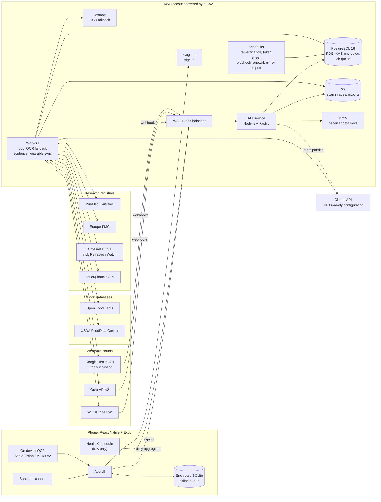
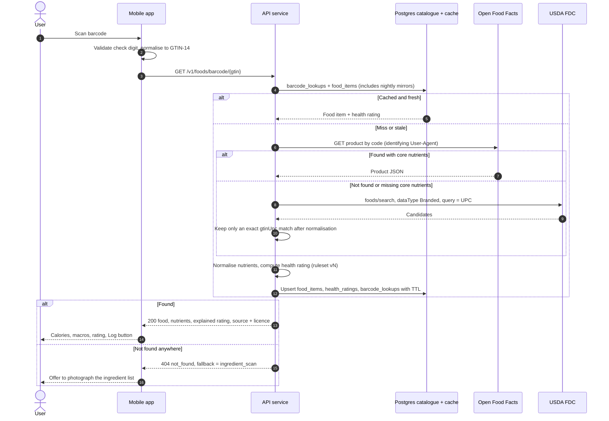
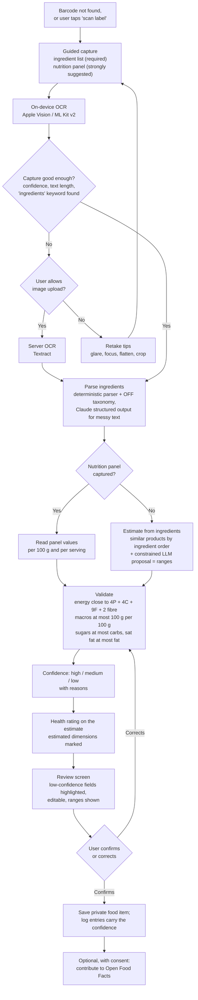
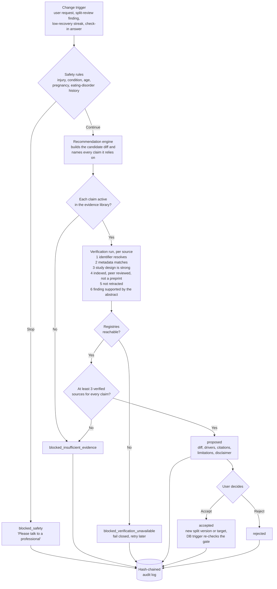
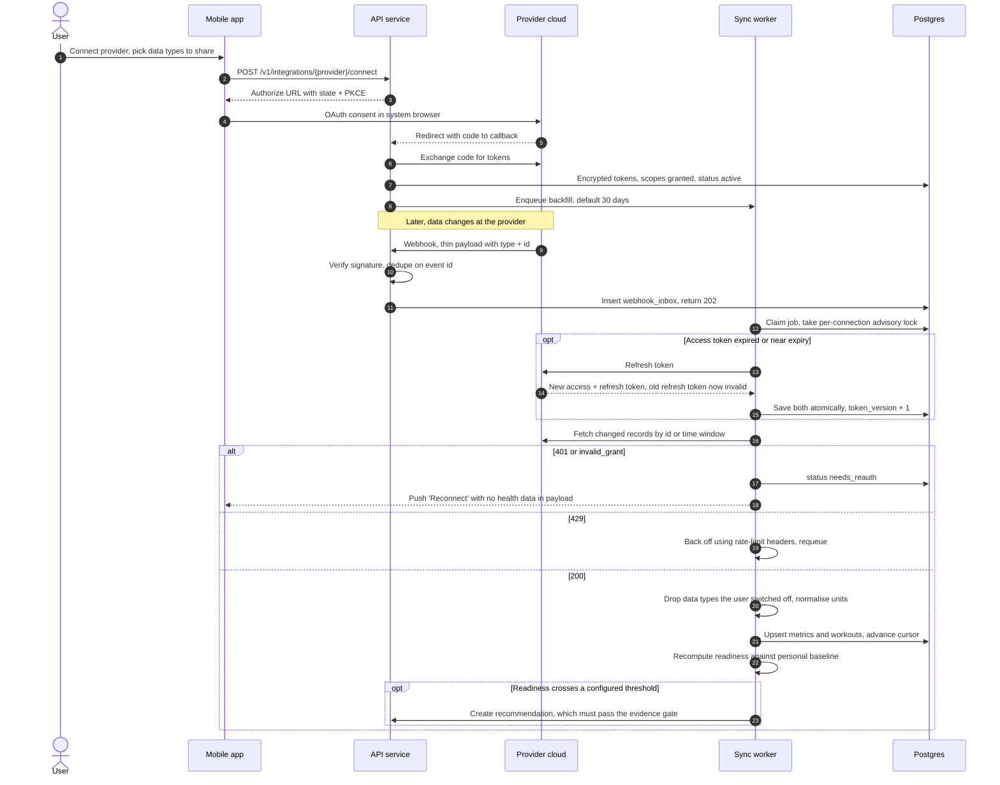
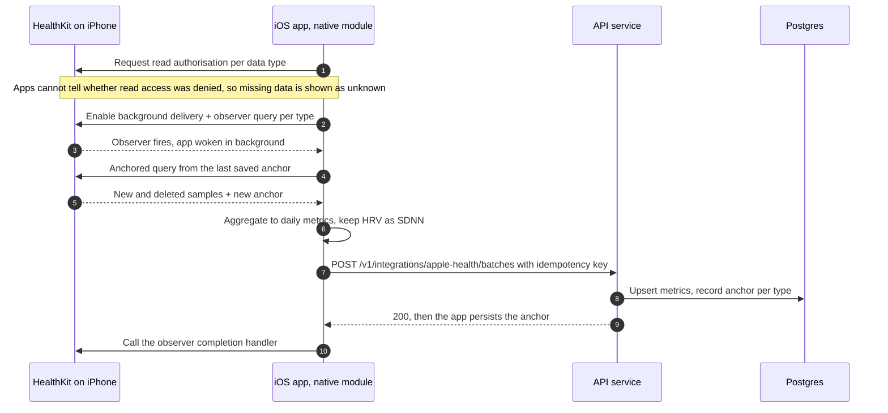
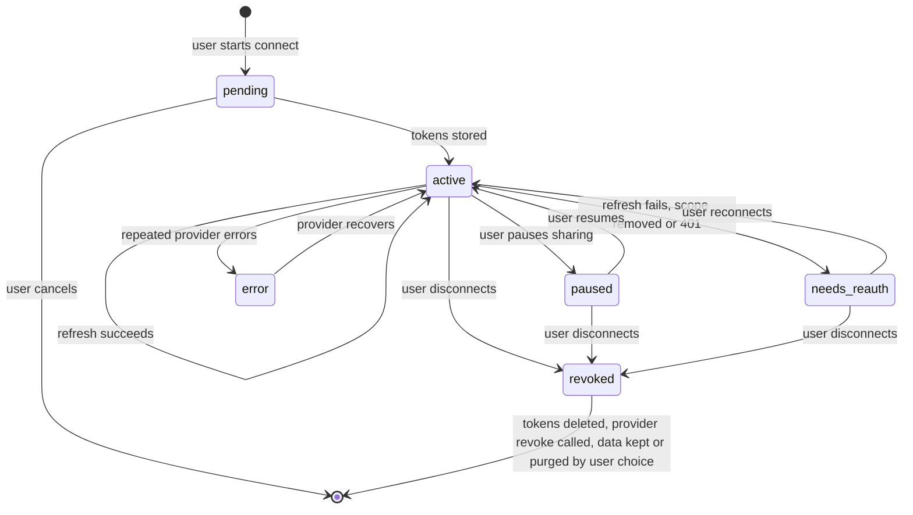

# 3. Architecture

This document has six diagrams: one system overview, then the four flows the brief asks for (barcode lookup, OCR fallback, research verification, wearable sync), plus the wearable connection lifecycle. Each diagram is followed by the rules that do not fit in a picture.

## 3.1 System overview

**What runs where**

| Component | Responsibility | Why it lives there |
|---|---|---|
| Phone | Barcode decoding, first-pass OCR, HealthKit reads, offline food log, encrypted local cache | Fast and private: label photos and Apple Health data are processed on the device by default, and HealthKit has no server API. |
| API service | Auth checks, validation, reads/writes, OAuth callbacks, webhook intake (verify, store, return 202) | Stateless, so it scales horizontally. Inside a user request it calls a third party in only two places, each with a time budget: the barcode path (behind the cache) and parsing a short change request into an intent with Claude. |
| Workers | Everything slow or retryable: food-source fallbacks, server OCR, LLM calls, evidence verification, wearable fetches, exports, deletions | A Postgres-backed queue (pg-boss) keeps jobs in the same encrypted, backed-up database, with no extra datastore to bring into compliance scope. |
| Scheduler | Periodic jobs: weekly retraction sweep, monthly full re-verification, Oura webhook renewal, proactive token refresh, nightly Open Food Facts and FDC mirror import | Cron-style jobs enqueued into the same queue. |
| Claude API | Ingredient normalisation, constrained macro estimates, parsing a user's request into a structured intent, phrasing follow-up questions, judging whether an abstract supports a finding | Called from workers, except intent parsing, which the API calls directly with a short time budget. Always uses structured outputs. Research prompts never include user data. |

**Domain engines.** These are pure TypeScript functions in `packages/domain`, used by both the app and the server:

* **Health-rating engine.** Turns nutrients, ingredients and NOVA group into explained dimensions. The rules are versioned; see [07 §7.4](07-product-flows.md#74-health-rating-explainer).
* **Split analyser.** Computes weekly weighted sets per muscle, frequency, recovery spacing, overlaps and goal fit, and produces *descriptive* findings.
* **Recommendation engine.** Turns an intent or finding into a candidate diff and names the claims it relies on. It cannot publish anything: only the evidence gate can move a recommendation to `proposed`.
* **Readiness model.** Compares today's HRV, resting HR and sleep with the user's own rolling baseline, separately per device, and records which inputs drove the result.

## 3.2 Barcode lookup

Rules:

1. **Normalise first.** UPC-A (12 digits), EAN-13 and GTIN-14 for the same product differ only by leading zeros. Validate the check digit on the device, zero-pad to 14 digits, and use that as the key everywhere. Open Food Facts and FDC store codes in different lengths, so match on the normalised value only.
2. **Use a local mirror.** The Open Food Facts documentation (as of October 2026) limits product reads to about 15 requests per minute per IP and search to 10, and FDC allows 1,000 requests per hour per IP. A server that forwards every scan would hit those limits with a few hundred active users. So:
   * Import the Open Food Facts and FDC Branded Foods bulk exports nightly into `food_items`. Most scans are answered locally.
   * Use the live API only for cache misses, with a token-bucket limiter below the published limits.
   * Cache negative results with a short TTL (24 hours) so a burst of scans of an unknown product does not fan out.
   * Optional: on a mirror miss, let the device query Open Food Facts directly. Its docs say limits then apply per user rather than to our server. Results still go through the server for normalisation and rating.
3. **Never mix nutrient sources silently.** If Open Food Facts has the product but lacks core nutrients and FDC has a match, use FDC's nutrients, keep Open Food Facts' ingredients and NOVA group, and record both sources on the item.
4. **Time budget.** The barcode endpoint has 2.5 s end to end. If upstream is slow, the API returns `202 pending` and the app polls. The user is never stuck on a spinner.
5. **Licence and attribution.** Items from Open Food Facts carry `ODbL-1.0` and an attribution string that the UI shows. FDC data is public domain (CC0).

## 3.3 Ingredient-photo (OCR) fallback

Rules:

1. **An ingredient list alone cannot give an accurate calorie count.** It lists ingredients in descending order of weight, and only sometimes gives percentages. It never gives quantities. The app therefore asks for the nutrition panel as well, and when it can only see ingredients it shows **ranges** and marks the result `low` confidence. It never shows false precision.
2. **How ingredient-only estimation works.**
   * (a) Parse and canonicalise the ingredients using the Open Food Facts ingredient taxonomy.
   * (b) Find mirror products whose canonical ingredient prefixes and stated percentages are most similar.
   * (c) Take the spread of their per-100 g nutrients as a prior.
   * (d) Ask Claude for a point estimate inside that prior, using structured output with a fixed JSON schema.
   * (e) Reject any value that breaks the physical constraints in node K.

   The LLM narrows a range. It never invents a value outside the range.
3. **Confidence rules** (all configurable):
   * `high` needs a panel that was read cleanly and an energy cross-check within 15%.
   * `medium` means a panel read with at most two corrected fields, or ingredient-only with at least 5 close mirror neighbours and a narrow range.
   * Everything else is `low`.

   Every `low_confidence_reason` is shown to the user in plain words.
4. **Privacy.** Photos stay on the device unless the user turns on `scan_image_upload`. Uploaded images are deleted by S3 lifecycle after 30 days, or sooner when the scan is confirmed.

## 3.4 Research verification (the evidence gate)

### Decision path for a change

### How claims get into the library (offline, human-reviewed)

```mermaid
flowchart LR
  D["Evidence editor drafts a claim<br/>statement + population scope"] --> R["Candidate retrieval<br/>PubMed and Europe PMC queries<br/>with publication-type filters"]
  R --> T["Triage assist<br/>Claude ranks retrieved records and drafts<br/>finding, limitations, verbatim quote"]
  T --> V["Automated checks 1-6"]
  V --> H["Human review<br/>qualified reviewer approves<br/>each claim-source link"]
  H --> A["Claim active<br/>at least 3 verified sources"]
  A --> W["Scheduled sweeps<br/>weekly retraction check,<br/>monthly full re-verification"]
  W -- "Problem found" --> SU["Suspend claim, withdraw open proposals,<br/>alert users who accepted a change"]
```

The principles are below. [06-evidence-gate.md](06-evidence-gate.md) has the full specification.

* **The LLM never originates a citation.** Records come only from PubMed, Europe PMC and Crossref by identifier. Claude may rank, summarise and judge records it is given, and every quote it produces must match the abstract character for character.
* **Curate claims, verify sources, re-check at decision time.** Library curation is slow and human-reviewed. A user request is fast because it reuses active claims, but the identifier and retraction checks are re-run if the cached result is older than 7 days.
* **Fail closed.** If the registries cannot be reached, nothing is proposed.
* **Enforced twice.** The application enforces the gate, and so does the database. Triggers in [`schema.sql`](../schema/schema.sql) refuse `proposed` or `accepted` unless every named claim is active and has at least 3 verified sources. They also refuse any app-originated split version or nutrition target that lacks an accepted recommendation.

## 3.5 Wearable sync

### Cloud providers (WHOOP, Oura, Google Health API)

### Apple Health (on-device only)

### Connection lifecycle

Rules:

1. **Webhooks first, polling as a safety net.** All three cloud providers send webhooks. A daily reconciliation poll per connection catches missed deliveries. Oura webhook subscriptions expire and are renewed by the scheduler.
2. **Refresh-token rotation is a race.** On refresh, WHOOP replaces both tokens and invalidates the old refresh token. Two workers refreshing at once will log the user out. Every refresh therefore runs under a per-connection Postgres advisory lock with an optimistic `token_version` check.
3. **The user controls the data.**
   * `data_types_enabled` is enforced at ingest: values the user switched off are never written.
   * It is enforced again at recommendation time: a disabled metric can never be a driver.
   * Pausing stops fetching. Disconnecting revokes at the provider where an endpoint exists, deletes the tokens, and asks whether to keep or purge the history.
4. **Normalisation that does not lie.**
   * HealthKit reports HRV as **SDNN**. WHOOP, Oura and Fitbit report **RMSSD**-based values measured during sleep. They are stored as different metrics and never compared across devices.
   * Vendor recovery and readiness scores are proprietary. They are shown with the vendor's name and are not converted to a common scale.
   * Readiness is computed per device, against that device's own 28-day baseline, and the UI shows the drivers. For example: "HRV 41 ms vs your Oura baseline 52 ± 6 ms."
5. **Precedence.** When two devices report the same metric, the user picks a primary source per metric. The default order is: the device worn overnight for sleep and HRV, then the phone for steps.
