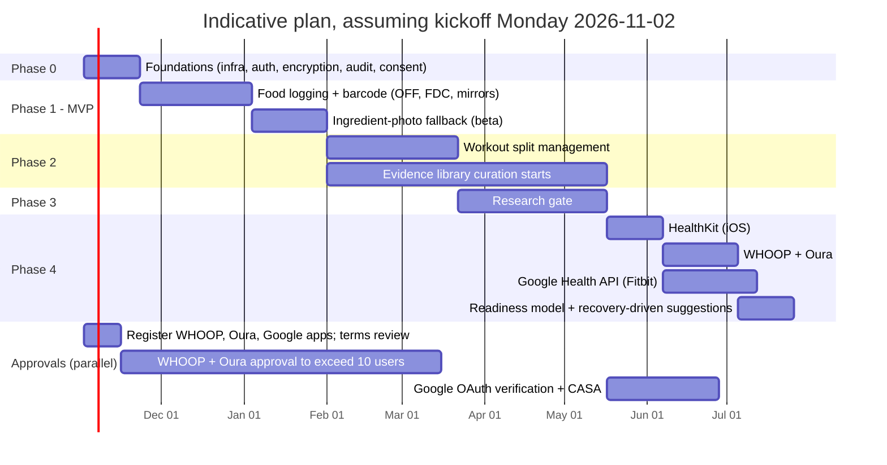

# 4. Phased build plan

The order follows the brief: MVP (food logging and barcode scanning), then workout split management, then the research gate, then wearable integrations. Two things are added: a short **Phase 0** for foundations, and a **partner-approval track** that starts in week 1, because wearable approvals take longer than the code.

**Sequencing consequence.** Until the research gate ships in Phase 3, the app cannot *propose* split or nutrition-target changes. Phases 1–2 therefore deliver logging, analysis and user-directed edits, with diffs. The database rejects any `app_recommendation` change that lacks an accepted, evidence-gated recommendation, so this cannot slip by accident.

**Assumed team:**

* 2 mobile/full-stack engineers;
* 1 backend/platform engineer;
* a part-time product designer;
* a part-time **evidence editor** (a registered dietitian or exercise physiologist with research-appraisal experience) from Phase 2;
* privacy counsel on call;
* an external security assessor for the pen test and Google's CASA.

Durations are indicative and assume that team.

## 4.1 Timeline

In round numbers: Phase 0, 3 weeks; Phase 1, 10 weeks; Phase 2, 7 weeks; Phase 3, 8 weeks; Phase 4, 10 weeks. That is about 38 weeks to all four phases with one team, and less if Phase 4 starts in parallel with Phase 3 on a second team.

## 4.2 Phase 0: Foundations (about 3 weeks)

| Deliverable | Notes |
|---|---|
| Monorepo, CI, Expo development builds, staging and production AWS accounts (Terraform) | AWS BAA signed; only HIPAA-eligible services are used for health data. |
| Cognito auth (Apple, Google, email), API skeleton, zod contracts, OpenAPI generation | |
| Postgres with migrations from `schema.sql`, RLS roles, KMS envelope encryption library, audit-log writer | The gate and audit invariants exist from day one. |
| Consent model, versioned disclaimer, privacy policy draft, PHI-free logging | Privacy counsel reviews which laws apply (see risks). |
| Export and delete pipelines (skeleton) | Privacy features ship with the MVP, not later. |

**Exit criteria:** `schema_test.sql` runs in CI; a request without a user context reads zero user rows; log scrubber tests pass.

## 4.3 Phase 1: MVP, food logging and barcode scanning (about 10 weeks)

**1a. Logging and barcode (6 weeks)**

* Onboarding with the required steps only; basic profile; user-entered nutrition targets.
* Barcode scanning (on-device decode, GTIN-14 normalisation) → mirror/cache → Open Food Facts → FDC.
* Nightly import of the Open Food Facts and FDC Branded Foods exports.
* Food search, custom foods, quick add, recent foods.
* Offline logging with idempotent sync.
* Health-rating explainer v1 (ruleset `hr-v1`, thresholds confirmed against the primary documents by the evidence editor).
* Dashboard v1: calories and macros vs target, and the estimated-entry count.
* Data export (JSON + CSV) and account deletion with crypto-shredding.

**1b. Ingredient-photo fallback, beta (4 weeks)**

* Guided capture (ingredients plus optional panel), Apple Vision / ML Kit OCR, opt-in Textract fallback.
* Ingredient parser on the Open Food Facts taxonomy; panel reader; estimation from similar products with constrained Claude; physical-consistency validator.
* Confidence scoring with plain-language reasons; review and correct screen; confirm creates a private food.
* **Benchmark set:** about 300 real label photos with hand-transcribed ground truth, covering glare, curved packs, small print, multiple languages, and with and without a panel.

**Proposed exit criteria** (set the final numbers after a baseline run):

* p95 barcode response under 1.5 s when served from the mirror.
* On the benchmark: at least 95% ingredient-token accuracy on good captures; every ingredient-only estimate flagged `medium` or `low`; no `high` confidence result with energy more than 15% off the ground truth.
* Export contains every user table; deletion leaves no rows and destroys the key.

**Not in the MVP:** app-proposed targets, splits, wearables, social features.

## 4.4 Phase 2: Workout split management (about 7 weeks)

* Exercise catalogue (about 150 exercises to start) with muscle credits and equipment, reviewed by the evidence editor.
* Split editor: days, exercises, sets, reps, RIR, rest, cardio blocks. Templates. Weekly volume per muscle calculated live (shared `packages/domain`).
* Immutable versions with structured diffs, and a history view for user edits.
* Split analyser with descriptive findings (volume, imbalance, frequency, recovery spacing, overlap, goal mismatch, constraints, injury conflicts).
* Workout logging (sets, reps, load, RIR, session RPE, soreness) and the training-load dashboard card.
* Change-request intake: natural language → structured intent (Claude) → user confirms. Explicit edits apply as *Your edit*. Goal-level requests produce an internal draft behind a feature flag, not shown to users, until Phase 3.
* Follow-up question framework with the fixed question bank and triggers.
* **In parallel:** the evidence editor starts drafting the first claims that the planned rules need (volume, frequency, rep ranges for strength vs hypertrophy, rest days, protein intake, energy deficit rate, running progression).

**Exit criteria:**

* Analyser unit tests against a fixture library of real-world splits.
* The diff renderer handles every operation type.
* No code path can write `origin = app_recommendation`, and a DB test proves the insert fails.

## 4.5 Phase 3: Research gate (about 8 weeks)

* Registry clients (PubMed E-utilities with an API key, Europe PMC, Crossref, doi.org handles) with caching, rate limits and retries.
* The six checks (see [06-evidence-gate.md](06-evidence-gate.md)), the Claude judge prompt, and a **judge evaluation set**: labelled claim–abstract pairs including hard negatives (wrong direction, wrong population, a quote not in the abstract, a summary that overstates).
* Admin review tool: draft claim → retrieve candidates → automated checks → reviewer sign-off → activate.
* Gate service and recommendation lifecycle; citation cards; "insufficient evidence" and "verification unavailable" states; frozen evidence snapshots; full history view.
* Weekly and monthly sweeps; retraction alerts; withdrawal of open proposals; user notification and revert offer.
* App-proposed changes switched on, for active claims only. Initial library target: 15–25 claims, each with at least 3 verified sources.

**Exit criteria:**

* Red-team suite, all rejected: a fabricated DOI, a real DOI with a mismatched title, a preprint, a narrative review, a known retracted paper, a correct paper with an overstated summary, and the registries being unreachable (fails closed).
* The judge produces **zero** false `supports` on the hard-negative set.
* Any recommendation can be replayed from the audit trail.
* An external reviewer audits a sample of 20 active claim–source pairs.

## 4.6 Phase 4: Wearable integrations (about 10 weeks)

* **HealthKit (iOS):** native module, authorisation per type, observer and anchored queries with background delivery, daily aggregation on the device (HRV kept as SDNN), batch upload, Apple Watch workouts. App Store review notes explain each HealthKit type used.
* **WHOOP API v2:** OAuth with the `offline` scope, webhooks (set to v2 in the dashboard), refresh under a per-connection lock, rate-limit handling (100/min and 10,000/day by default).
* **Oura API v2:** OAuth only (personal access tokens are gone), webhook subscriptions per data type and event, a scheduled renewal job, and messaging for Gen3 users without a membership.
* **Google Health API** (not the Fitbit Web API, which shuts down on 2026-10-30): Google OAuth with restricted scopes, webhooks, re-consent flow for any former Fitbit users, OAuth app verification and the annual CASA assessment.
* Normalisation, per-device baselines, readiness model v1 with drivers, data-type controls, pause and disconnect with keep/purge.
* Recovery-driven suggestions go through the gate. Where no active claim supports an automatic adjustment, the app shows the data and makes no change.
* *Stretch:* Android Health Connect as a second on-device source.

**Exit criteria:**

* Concurrent-refresh test: 2 workers, 1 connection, no logout.
* Webhook replay is idempotent.
* Data types the user switched off are never stored (tested at ingest).
* Disconnect revokes and deletes the tokens.
* 30-day backfill completes within rate limits.
* Readiness drivers match the stored metrics.

## 4.7 Cross-cutting work in every phase

* Privacy review of each new data type before it ships; data-map update; the export covers it.
* Security: dependency and secret scanning in CI; pen test before public launch and after Phase 4; OWASP ASVS-aligned controls (CASA uses ASVS).
* Accessibility: dynamic type, screen-reader labels on every chart and citation card.
* Evaluation: OCR benchmark and judge evaluation re-run on every model or prompt change, with results stored alongside the version.
