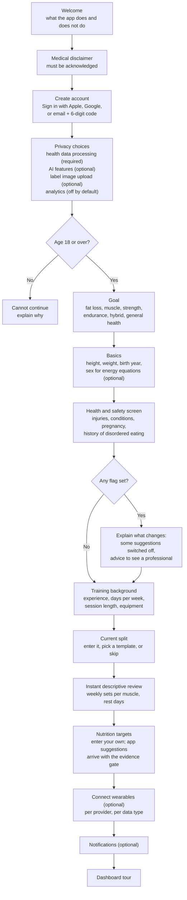

# 7. Product flows and domain rules

This document covers the product requirements behind the five deliverables: onboarding, the dashboard, the history view, how the health rating is explained, how splits are reviewed and changed, follow-up questions, wearable sharing controls, and safety rules.

The visual design of these screens (Apple Design System tokens, components, palettes and mockups) is in [08-ui-design.md](08-ui-design.md).

## 7.1 Onboarding



Design rules:

* Required steps are kept to: disclaimer, account, health-data consent, age gate and goal. Everything else can be skipped and revisited from Settings.
* Every consent screen states what is collected, why, who processes it, and how to withdraw. Each is saved as a `consents` row with its document version.
* The health and safety screen asks yes/no questions first and optional free text second. Free text is stored encrypted (`health_notes_enc`).
* Onboarding never suggests calorie targets before Phase 3 (see the build plan). Users enter their own targets, or skip.

## 7.2 Dashboard (home)

| Card | Content | Data source |
|---|---|---|
| **Today's food** | Gauges (the design system's `StatGauge`) for calories, protein, carbs, fat and fibre vs target; "2 of today's 7 entries are estimates" with a link to review them | `daily_nutrition`, `nutrition_targets` |
| **Training load (this week)** | Weighted hard sets per muscle vs plan (bar per muscle group, so under- and over-shooting are visible); sessions done vs planned; cardio minutes; the vendor's own load score (e.g. "WHOOP strain") labelled by vendor if connected | `set_logs`, `split_versions.weekly_volume`, `wearable_workouts` |
| **Recovery** | Readiness level (normal, reduced, low or unknown) with its drivers in plain words, e.g. "HRV 41 ms vs your Oura 28-day baseline 52 ± 6 ms" and "Slept 5 h 40 min vs your 7 h 15 min average". Each driver names the device and the date. Vendor recovery and readiness scores are shown separately, with the vendor's name. | `readiness_snapshots`, `wearable_daily_metrics` |
| **Suggestions** | Pending recommendations with a one-line rationale and a "Why?" link to the diff, drivers and citations | `recommendations` |
| **Data status** | Last sync per provider, "Reconnect Oura" when reauthorisation is needed, and a note when a data type is paused | `wearable_connections` |

## 7.3 History view

* **Split timeline.** One entry per version. Each shows:
  * the version number and date;
  * where it came from: *Your edit*, *Suggestion you accepted* or *Imported*;
  * a diff summary and weekly-volume deltas.

  Tapping an accepted suggestion opens its frozen record: the drivers as they were, the citations exactly as shown, the verification results and date, the engine and model version, and the disclaimer version.
* **Nutrition target timeline.** Same structure for target changes.
* **Not changed.** A filter shows suggestions that were blocked (insufficient evidence, safety, verification unavailable) or rejected, with the reason. The user can see what the app chose *not* to do.
* **Alerts.** If a cited source is later retracted, the affected entry shows a banner and offers to revert to the previous version.

## 7.4 Health-rating explainer

The rating is a list of dimensions, each with a level, the number behind it, the threshold it was compared against, and one plain-language sentence. There is no overall score. Nutri-Score, when Open Food Facts has one, is shown only under "More details" with a note on what it is.

| Dimension | Rule (per 100 g of food / per 100 ml of drink) | Reference |
|---|---|---|
| Sugar (total sugars) | Low ≤ 5.0 g (drinks ≤ 2.5 g); high > 22.5 g (drinks > 11.25 g); medium in between | UK front-of-pack labelling guidance (DHSC/FSA, 2016 revision) |
| Salt / sodium | Low ≤ 0.3 g salt; high > 1.5 g salt (drinks > 0.75 g); salt = sodium × 2.5 | UK front-of-pack guidance |
| Saturated fat | Low ≤ 1.5 g (drinks ≤ 0.75 g); high > 5.0 g (drinks > 2.5 g) | UK front-of-pack guidance |
| Total fat (secondary detail) | Low ≤ 3.0 g (drinks ≤ 1.5 g); high > 17.5 g (drinks > 8.75 g) | UK front-of-pack guidance |
| Fibre | "Source of fibre" ≥ 3 g per 100 g or ≥ 1.5 g per 100 kcal; "high fibre" ≥ 6 g per 100 g or ≥ 3 g per 100 kcal | Regulation (EC) No 1924/2006, Annex |
| Protein amount | "Source of protein" when ≥ 12% of energy comes from protein; "high protein" at ≥ 20% | Regulation (EC) No 1924/2006, Annex |
| Ultra-processing | NOVA group (from Open Food Facts, or computed from ingredients), plus the specific markers found: additive classes (emulsifiers, non-sugar sweeteners, flavour enhancers, colours), and industrial ingredients such as protein isolates, maltodextrin, invert sugar and hydrogenated oils | NOVA classification. The UI states that NOVA describes processing, not nutrient content. |
| Protein quality | Identifies the main protein sources by ingredient position and percentage. Animal proteins and soy are labelled "complete"; single plant sources such as wheat or pea are "may be limited in some essential amino acids"; blends are noted as blends. Always marked as an estimate, because labels do not give amino-acid profiles. | Heuristic, reviewed by the evidence editor; confidence shown |

Rules:

* Before showing any threshold, the evidence editor confirms the exact values against the primary documents: the FSA guidance PDF and the consolidated text of Regulation 1924/2006. They go into a versioned ruleset (`ruleset_version`).
* Each sentence gives the number and the threshold, and also the per-serving amount when a serving size is known. Example: "28 g sugar per 100 g is above the UK 'high' level of 22.5 g. One 40 g bar has about 11 g."
* If a nutrient is missing, the dimension says "Not on the label or in the database" (`data_gaps`) and is not guessed.
* For estimated foods (ingredient scans), each dimension carries the estimate's confidence. When a range spans two bands the UI says so, e.g. "medium to high".
* These are regulatory reference values for *describing* a food. They are not changes to the user's targets, so the 3-source gate does not apply, but each dimension still links to its reference.

## 7.5 Split review (descriptive findings)

The analyser runs on every new version and on request. Findings are facts plus a comparison, never instructions.

| Code | What is measured | Comparison |
|---|---|---|
| `weekly_volume` | Weighted hard sets per muscle per week (`set_credit` per exercise) | Against the range in the active volume claim for the user's goal; if no active claim, shown with no reference band |
| `volume_imbalance` | Ratios: horizontal push vs pull, vertical push vs pull, quads vs hamstrings; muscles with zero direct work | Against configured bands; flags outliers |
| `frequency` | Sessions per week that train each muscle | Flags muscles trained once a week (reference band comes from a claim, when one is active) |
| `recovery_spacing` | Hard sessions for the same primary muscle on consecutive days; days with no rest in a 7-day week | Flags back-to-back hard sessions and weeks with no rest day |
| `overlap` | Same movement pattern and primary muscle repeated within a session beyond N sets | Flags redundancy |
| `goal_mismatch` | Strength goal with no main-lift sets of 6 reps or fewer; hypertrophy goal with most sets far from failure (RIR > 4); endurance or hybrid goal with no aerobic work; week-to-week running distance jumps beyond the configured threshold | Flags a mismatch with the stated goal |
| `constraint_violation` | Session length over the user's limit; exercise needs equipment the user does not have | Flags it |
| `injury_conflict` | Exercise loads a region the user has flagged | Safety: the app makes no suggestion for that region and recommends a professional |

Turning a finding into a suggestion is a separate step that goes through the recommendation engine and the evidence gate.

## 7.6 Change requests and diffs

| Intent | Example request | What the engine does |
|---|---|---|
| `develop_muscle` | "Bigger shoulders" | Adds weekly sets for that muscle within its claim-backed range. Picks exercises from the catalogue by muscle credit, equipment and time. Keeps the session time limit. |
| `switch_style` | "Hypertrophy → strength", "add running", "hybrid" | Builds a new version from a style template whose rep ranges, frequencies and run progression each cite claims. Asks follow-up questions first (running history, available days). |
| `add_exercise` / `remove_exercise` | "Add hip thrusts" | If the user gives the full details, it is a user edit. If they ask the app to fit it in, the engine places it and gates the volume change. |
| `change_days` / `change_session_length` | "Only 3 days now" | Redistributes volume and keeps each muscle within its claim-backed range where possible. Shows what had to be dropped. |

How a diff is shown:

```
Upper / Lower, 4 days · v3 → v4 (suggested)
Mon · Upper A
  + Lat pulldown              3 × 8–12, 2 reps in reserve
Thu · Upper B
  ~ Chest-supported row       2 → 3 sets
Weekly volume (weighted sets)
  Lats         6   → 9.5   (+3.5)
  Upper back   7   → 9.5   (+2.5)
  Biceps       6   → 8     (+2)
Session time   Upper A 52 → 58 min (your limit: 60)
Why: 1 claim · 3 verified studies · based on your goal and current lat volume
```

## 7.7 Follow-up questions

The questions come from a fixed bank. The LLM may only rephrase them. Each question has a trigger and states what its answer changes.

| Trigger | Questions | What the answer changes |
|---|---|---|
| New split or style switch | Experience, equipment, available days, session length, running history (for running or hybrid) | Engine constraints and claim scope |
| Progress stalled (estimated 1RM or reps flat for 3+ weeks on a main lift) | Sleep, nutrition adherence, soreness, stress, technique concerns | Whether a volume or recovery change is considered (gated) |
| Low readiness for 3+ days | Illness, travel, unusual stress, alcohol, new medication (optional) | Holds suggestions and asks before any change; illness or medication → "check with a professional" |
| Missed sessions | Schedule changes | May offer a `change_days` request |
| New pain reported | Location, severity, onset | Sets `injury_reported`; blocks suggestions for that region and recommends a professional |
| Every 6–8 weeks | Goal still the same? Equipment changed? | Keeps the profile current |

## 7.8 Wearable data controls

* There is a toggle per provider and per data type: sleep, HRV, resting heart rate, recovery or readiness, workouts, daily activity, heart rate.
* Each data type explains how the app uses it. Example: "HRV and resting heart rate: used to estimate readiness compared with your own baseline. Never shared."
* **Pause sharing** stops fetching and stops using the data in suggestions. **Disconnect** revokes and deletes the tokens and asks "Keep or delete the data already synced?"
* Every suggestion's drivers name the provider and data type. A data type that is switched off can never be a driver.

## 7.9 Safety rules (hard rules in code, not suggestions)

| Flag | Effect |
|---|---|
| `under_18` | Onboarding stops. The app is for adults. |
| `eating_disorder_history` | No calorie-deficit or weight-loss target suggestions. Calorie numbers can be hidden from the dashboard. Shows a "talk to a professional" resource. |
| `pregnancy` | No automatic training or nutrition suggestions. Logging still works. Shows a professional-advice note. |
| `injury_reported` | No suggestions that load the flagged region. Exercises in that region are excluded from generated plans. Professional-advice note. |
| `condition_reported` | Suggestions are held. Optional `clinician_supervised` flag (user-attested) lifts the hold, with the note kept on every suggestion. |
| Any user | Nutrition target suggestions have a configurable minimum calorie floor and a maximum rate of change, set by the evidence editor. The floor is a safety constraint, not a recommendation. |

## 7.10 Disclaimer text and placement

> **This app provides general fitness and nutrition information. It is not medical advice and does not diagnose, treat or prevent any condition. If you have an injury, a medical condition, are pregnant, or have a history of disordered eating, talk to a qualified healthcare professional before changing your training or diet.**

Shown in onboarding (must be acknowledged), at the bottom of every suggestion and every citation screen, in Settings → About, and in every data export. The text is versioned (`disclaimer_version` on each recommendation).
