# 8. UI design: Apple Design System

The app's interface uses the **Apple Design System**, a quiet, photography-first system with a single accent colour (Action Blue). Its rules, tokens, components and screen blueprints come from the design system artifact (<https://claude.ai/artifact/BrNgeRewcYg8S2Gqw6B8Cs>). That artifact is itself synced from `rukkiecodes/claude-apple-design-system@a7dc950` (MIT).

This document applies the system to this app. Where the system already decides something, the app follows it. Where the app needs something the system lacks (health-rating states, evidence cards, switches), the extension is built from the system's own tokens and is listed in §8.9.

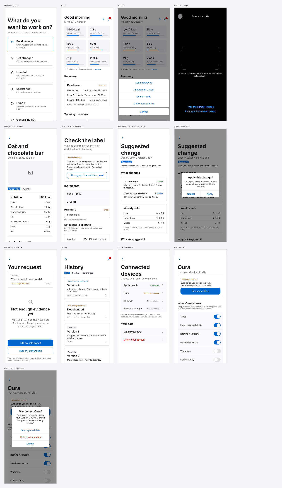

## 8.1 What is in the repository

| Path | What it is |
|---|---|
| `design/apple-design-system/tokens.json` | Copy of the system's tokens, synced 2026-10-12. **The source of truth for every colour, size, radius and weight in the app.** |
| `design/apple-design-system/bundle.css`, `bundle.js` | The system's web component bundle (React, `window.AppleDS`). Used only to render the mockups; the app gets React Native ports (§8.10). |
| `design/app-palettes.json` | This app's status palettes (§8.4), in the system's `StatusBadge` shape. |
| `design/generated/theme.ts` | Typed React Native theme generated from `tokens.json`; `defaultTheme = 'readable'`. |
| `design/generated/tokens.css` | CSS variables and type-style classes generated from `tokens.json` (for the mockups). |
| `design/scripts/build-tokens.mjs` | Regenerates both files above. Run it after re-syncing `tokens.json`. |
| `design/mockups/` | The 13 screens below, built from the real bundle components. |
| `design/scripts/render-mockups.mjs` | Renders the mockups to `design/screens/*.png` with headless Chromium. |

## 8.2 Theme: Readable by default

The system ships two themes:

* **Light** holds the brand's exact values.
* **Readable** darkens four text tokens by lightness only, keeping their hue, so they reach at least 4.5:1 for small text. It changes nothing else.

The system's own guidance is to use Readable "where WCAG AA for small text has to hold".

In this app, small text carries health meaning almost everywhere: rating levels ("High"), readiness ("Reduced"), estimate confidence, verification status, ranges and captions. AA therefore has to hold app-wide, so **Readable is the app's only theme**. The generated `theme.ts` sets `defaultTheme = 'readable'`.

| Token | Light (brand) | Readable (app) | Readable contrast |
|---|---|---|---|
| `inkMuted48` | `#7a7a7a` | `#6f6f6f` | 5.0:1 on `canvas` |
| `danger` | `#ff3b30` | `#e00c00` | 5.0:1 on `canvas`, white on it 5.0:1 |
| `success` | `#34c759` | `#218039` | 5.0:1 on `canvas` |
| `warning` | `#ff9500` | `#a35f00` | 4.6:1 on `canvasParchment` |

Even in Readable, `success` and `danger` differ by hue rather than lightness. Every state therefore always carries its word (§8.4).

**No dark mode yet.** The system has no dark theme; its dark tiles are surfaces inside the light theme. Adding one is a design-system decision, so it is listed as an open question in §8.12.

## 8.3 The system's eight rules, applied here

| Rule | What it means in this app |
|---|---|
| **One accent, ever** (`primary`) | Links, the main button, the active tab, the selected goal card, active filter chips, gauge fills, switches and the verified-evidence seal are all `primary`. There is no second brand colour. Food ratings never get a "healthy green" brand treatment. |
| **Pill CTAs** | "Log 1 bar, 165 kcal", "Apply change", "Reconnect Oura", search fields and meal/serving filter chips are pills. |
| **No chrome shadows** | Cards, sheets, alerts, toasts and buttons have none. `shadow-hero` is reserved for a product packshot resting on a surface, if one is ever used. |
| **Weight ladder 400 / 600 / 700** | Body 400; card titles and labels 600; headlines 700. The generated theme has no 500 style, and lint blocks `fontWeight: '500'` (§8.10). |
| **Hairlines, not borders** | Nutrition-facts rows, citation footers and grouped rows use 1px `hairline` / `dividerSoft`. Only the selected goal card gets 2px `primaryFocus`. |
| **Continuous corners** | Radii only from the scale (`radius-md` fields, `radius-lg` cards, `radius-xl` imagery, `radius-pill` actions), with `borderCurve: 'continuous'` on iOS. |
| **Air is the pedestal** | 24px gutter (`spacing-xl`), sections 32px apart (`spacing-xxl`), large titles that collapse on scroll, and content that never touches the screen edge. |
| **Alerts and sheets are ours** | Applying a change, disconnecting a device and deleting the account use `Alert`. "Add food" uses `Sheet`. No platform dialogs anywhere. |

## 8.4 App status palettes

`StatusBadge` takes a palette of `status → {bg, fg, label}`. The app's palettes live in `design/app-palettes.json` and follow the system's rules:

* every badge shows its **word**;
* status hues are state, never decoration;
* states that are open or awaiting a decision (a pending suggestion, a connection in progress) are **filled `primary`**;
* everything else is `canvasParchment` with a semantic foreground.

| Palette | States (foreground → word) | Used on |
|---|---|---|
| `nutrientToLimit` (sugar, salt, saturated fat, fat) | `success` Low · `inkMuted80` Medium · `warning` High · `inkMuted48` Not listed | Health rating |
| `nutrientToEncourage` (fibre, protein) | `success` High · `success` Source · `inkMuted80` Low | Health rating |
| `processing` | `success` Minimally processed · `inkMuted80` Culinary ingredient / Processed · `warning` Likely ultra-processed | Health rating |
| `estimateConfidence` | `success` High confidence · `inkMuted80` Medium confidence / Estimate · `warning` Low confidence / Check | Label check, food log |
| `readiness` | `success` Normal · `warning` Reduced · `danger` Low · `inkMuted48` Not enough data | Today, Recovery |
| `sourceVerification` | `success` Verified · filled Checking · `warning` Under review · `danger` Retracted | Evidence cards |
| `recommendation` | filled Suggested · `primary` Applied · `inkMuted80` Declined · `warning` Not enough evidence / Paused for your safety · `inkMuted48` Couldn't check yet · `danger` Withdrawn | Suggestions, History |
| `splitOrigin` | `inkMuted80` Your edit · `primary` Suggestion you applied · `inkMuted48` Imported | History |
| `diffOp` | `success` Added · `primary` Changed · `danger` Removed | Suggested change |
| `connection` | `success` Connected · filled Connecting · `warning` Reconnect needed · `inkMuted80` Paused · `danger` Sync problem · `inkMuted48` Not connected | Devices, Today |

Two deliberate choices about food:

* **A high nutrient is `warning`, never `danger`.** Eating sugar is not an error. The level is a measurement against a reference, and the word says which.
* **Gauges never turn red when you go over a target.** The calorie gauge stays `primary` and the value says "2,480 kcal, 180 over". There is no shaming colour.

## 8.5 Navigation and screen map

**Tabs:** Today (`house`) · Food (`fork.knife`) · Training (`dumbbell`) · Recovery (`heart`) · History (`clock.arrow.circlepath`). Use the platform's native tab bar styled to the `TabBar` tokens.

**Headers:**
* Tab roots use the collapsing `AppHeader` with `showBack={false}`, a `gearshape` settings button on the left and a `NotificationBell` on the right. The bell counts pending suggestions and reconnect requests.
* Today is the one exception, as the system specifies: a fixed hero with the greeting.

**Settings** (from the gear): Profile and goal · Targets · Connected devices · Privacy choices · Your data (export, delete) · About and disclaimer.

| Screen | System blueprint | Main components |
|---|---|---|
| Splash → onboarding slides → goal → email → code → profile basics → health screen → dashboard | Login and onboarding | `Card` (selectable), `Input`, `OtpInput`, `Button` |
| Today | Dashboard | `StatGauge`, `Card`, `StatusBadge`, `GroupedRows`, `NotificationBell` |
| Food, Training lists | Tab-root list screen | search `Input` (pill), filter `Chip`s, `Card` rows, `EmptyState` |
| Add food | — | `Sheet` |
| Barcode scanner | full-bleed photographic void (`surfaceBlack`) | translucent round control, `primaryOnDark` links |
| Food detail and rating | Detail screen | `AppHeader`, `Chip`, `Card`, grouped rows, `StatusBadge`, `Button` |
| Label check | Form sheet | `Card`, `Input`, `StatusBadge`, `Button` |
| Suggested change | Detail screen + `Alert` confirm | `Card`, `CardFooter`, `StatusBadge`, `Alert` |
| Not enough evidence | Detail screen + empty state | `EmptyState` layout, `Button` |
| History | Tab-root list screen | filter `Chip`s, `Card`, `StatusBadge` |
| Connected devices, device detail | Detail screen | `GroupedRows`, platform switch, `Button`, `Alert` |

Transient news uses `Toast`: "Logged 1 bar, 165 kcal", "Couldn't reach Oura. We'll try again." Any choice uses an `Alert`.

## 8.6 Key screens

All screens are 390-point iPhone width. They are rendered full length; a real device scrolls. Every number, product and name in them is illustrative.

### Onboarding: goal

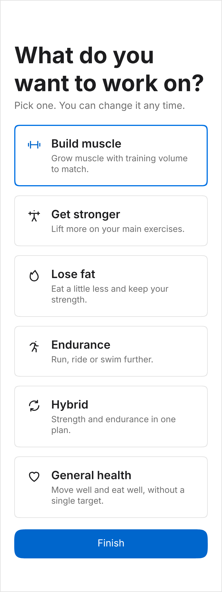

* This is the system's "account type" pattern: selectable `Card`s, 1px `hairline` becoming 2px `primaryFocus` when selected, a 28px leading icon going `ink` → `primary`, a `headline-semiBold` title and a `callout` `inkMuted48` line.
* "Continue" stays disabled until a goal is picked.
* The surrounding onboarding follows the system's journey: splash, three photo-led slides, goal, email, 6-digit code ("Enter the code"), profile basics, then the health and safety screen ([07 §7.1](07-product-flows.md#71-onboarding)). The medical disclaimer is its own plain screen that the user must acknowledge.

### Today (dashboard)

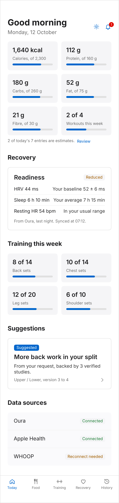

* The fixed hero has a `title3` greeting with settings and the bell. "Metrics are gauges, never plain number cards", so calories, protein, carbs, fat, fibre and workouts are `StatGauge`s, and so is this week's training volume per muscle group.
* The **Readiness** card shows the `readiness` badge with its word, and each driver as "value vs your baseline", naming the device and sync time. This is the brief's "show the data that drove each suggestion".
* A pending suggestion is a pressable `Card` with a filled "Suggested" badge.
* Estimated food entries are counted, with a "Review" link.

### Add food

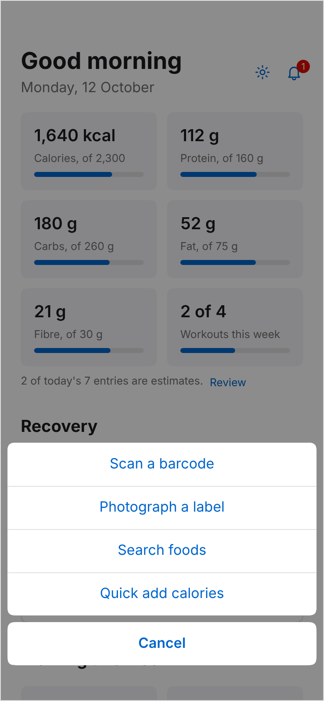

* The system's `Sheet`: options ordered by likelihood, with Cancel added by the component. The handler runs after the sheet dismisses (about 240 ms), so the camera presents cleanly.

### Barcode scanner

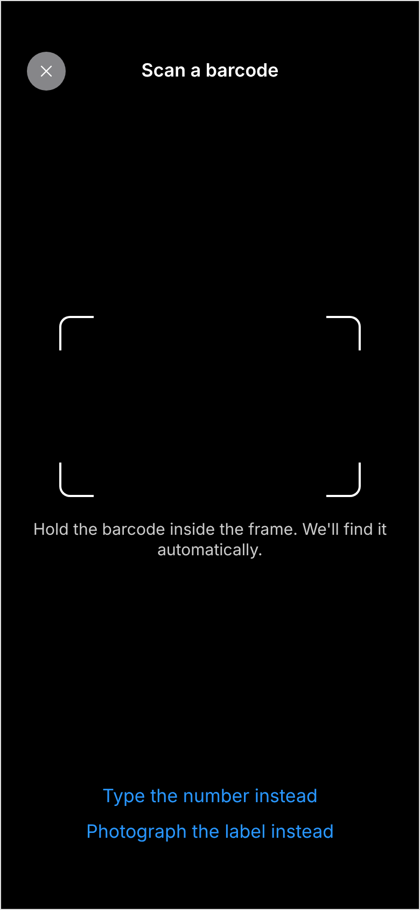

* This is the photographic void the system reserves `surfaceBlack` for: `onDark` title, `bodyMuted` instruction, and `primaryOnDark` text actions.
* The close control is a circle in `chipTranslucent` at about 64% alpha. The viewfinder brackets are 2px `onDark`, the thickest line the system allows.

### Food detail and health rating

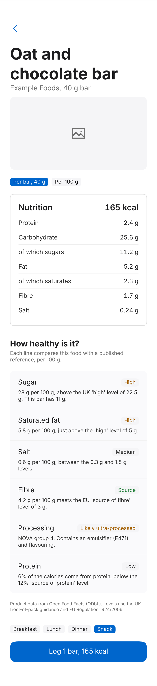

* Imagery leads: the product photo sits at `radius-xl` on a `canvasParchment` placeholder.
* Per-serving and per-100 g amounts are filter chips. Nutrition facts sit in a `Card` with `dividerSoft` rows and tabular figures.
* **"How healthy is it?"** is a grouped list. Each dimension has a word badge and one plain sentence giving the number and the reference. There is no overall score ([07 §7.4](07-product-flows.md#74-health-rating-explainer)).
* Data and rule attribution sit in `micro`. The meal is picked with chips, and the pill CTA states the outcome: "Log 1 bar, 165 kcal".

### Label check (OCR fallback)

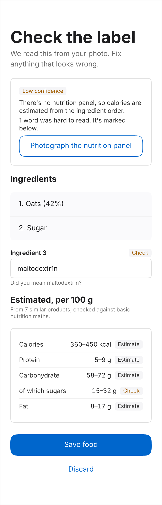

* Presented as a form sheet.
* Confidence is a word badge, and every reason is a plain sentence. The outline button offers the fix ("Photograph the nutrition panel").
* A doubtful OCR token is an `Input` with a "Check" badge and a hint ("Did you mean maltodextrin?"). It is not styled as an error, because it may be correct.
* Estimates are shown as **ranges**, each with a badge.

### Suggested change, with evidence

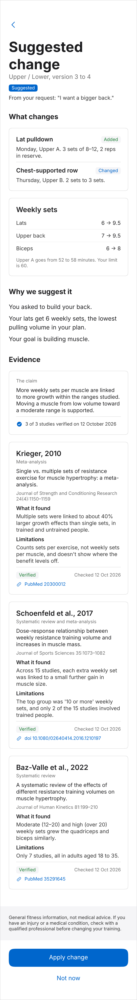

* The diff uses `diffOp` badges (Added, Changed), and weekly sets as "before → after" in tabular figures. The time cost is checked against the user's limit.
* "Why we suggest it" lists the drivers in plain words.
* The **Evidence** section has the claim card, with the `checkmark.seal.fill` seal and "3 of 3 studies verified on ⟨date⟩", then one card per study:
  * a short card title (author, year);
  * the study design;
  * the full title and journal;
  * "What it found" and "Limitations";
  * the verification badge, the date checked, and the identifier link.
* The disclaimer sits on a `canvasParchment` band; the change of surface is the divider. Then "Apply change" (primary) and "Not now" (ghost).

### Apply confirmation

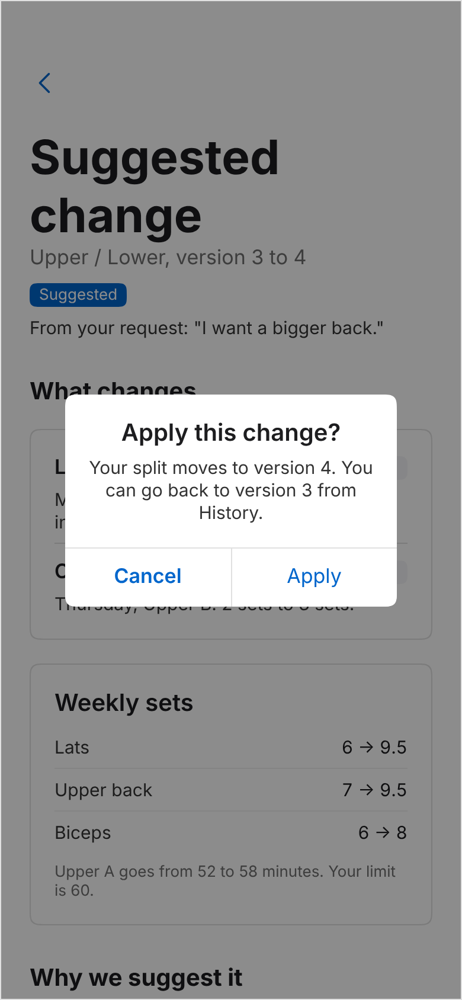

* `Alert`, phrased as a question, with outcome buttons ("Cancel", "Apply"). The message says how to undo.

### Not enough evidence

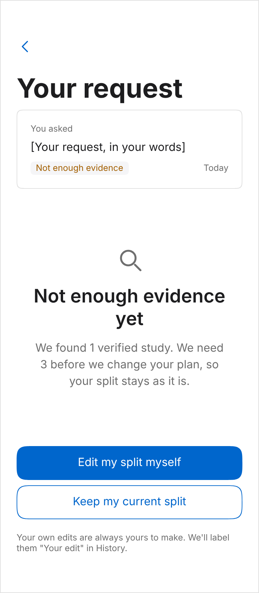

* The gate's "insufficient evidence" answer, presented as an answer rather than an error, using the `EmptyState` layout.
* It says what was found ("1 verified study"), what is needed (3), and that nothing changed. The user's own edit stays one tap away.
* The request text is a placeholder here, because the real evidence count depends on the claim library.

### History

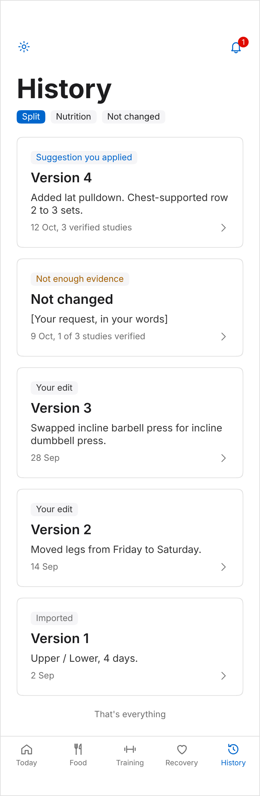

* Filter chips (Split · Nutrition · Not changed). Each version is a `Card` with its origin badge, a one-line summary, and the date plus evidence count in the footer. Tapping opens the frozen record ([07 §7.3](07-product-flows.md#73-history-view)).
* The list ends with "That's everything", as in the system's list blueprint.

### Connected devices, device detail and disconnect

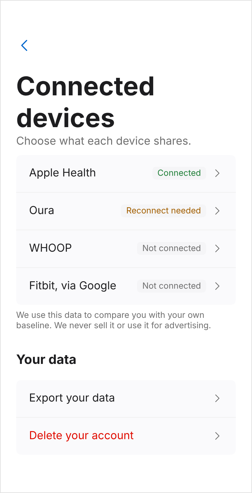 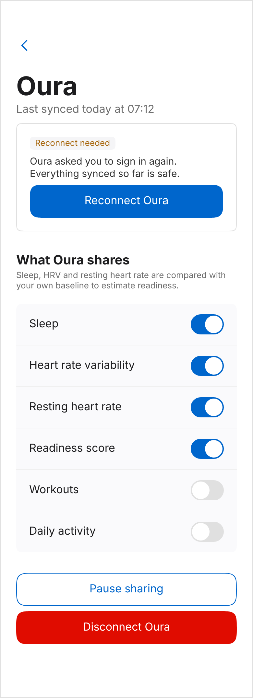 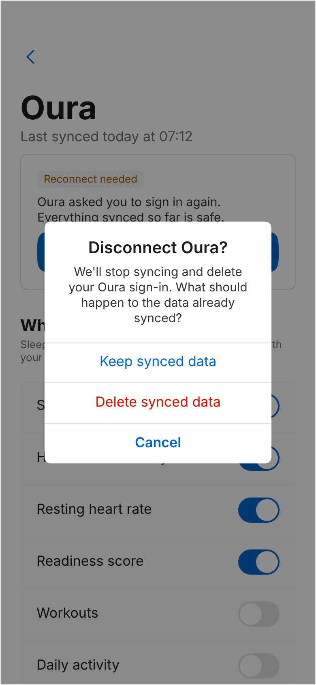

* Each provider shows its `connection` badge. "Delete your account" uses the `danger` row colour.
* Device detail:
  * the reconnect card (one primary button);
  * **one switch per data type**, which is the brief's "let users control what data is shared", explaining how the data is used;
  * "Pause sharing" (outline) and "Disconnect Oura" (danger).
* Disconnecting asks what to do with synced data: three stacked `Alert` buttons, the destructive one in `danger` and never the default.

## 8.7 Copy

The system's content rules, with this app's wording:

| Rule | Write | Not |
|---|---|---|
| Sentence case everywhere | "Connected devices", "How healthy is it?" | "Connected Devices" |
| You and we | "We couldn't find 3 verified studies…", "You can change this later." | "The system could not…" |
| Buttons name the outcome | "Log 1 bar, 165 kcal", "Apply change", "Reconnect Oura", "Photograph the nutrition panel" | "Submit", "OK", "Continue" (except in onboarding steps) |
| No emoji, no exclamation marks | "Logged 1 bar, 165 kcal" | "Nice work!" |
| Status by word, never colour alone | "High", "Reduced", "Verified", "Reconnect needed" | a red dot |
| Describe food, don't judge it | "28 g sugar per 100 g, above the UK 'high' level of 22.5 g" | "Unhealthy", "Bad choice" |
| Say what is estimated | "Estimated, per 100 g", "360–450 kcal" | "405 kcal" for an ingredient-only scan |
| One-line subtitles in plain fact | "Last synced today at 07:12" | Marketing copy |

## 8.8 Icons

Name every icon by its SF Symbol string and render it through one `Icon` component. Confirm each name exists in the SF Symbols app for the app's minimum iOS version.

| Concept | SF Symbol | Concept | SF Symbol |
|---|---|---|---|
| Today | `house` | Settings | `gearshape` |
| Food | `fork.knife` | Notifications | `bell` |
| Training | `dumbbell` | Scan barcode | `barcode.viewfinder` |
| Recovery | `heart` | Scan label | `text.viewfinder` |
| History | `clock.arrow.circlepath` | Photograph panel | `camera` |
| Search, no results, not enough evidence | `magnifyingglass` | Verified evidence | `checkmark.seal.fill` |
| Source link | `link` | Product photo placeholder | `photo` |
| Add | `plus` | Close | `xmark` |
| Back / disclosure | `chevron.left` / `chevron.right` | Export data | `square.and.arrow.up` |
| Delete | `trash` | Goal: strength | `figure.strengthtraining.traditional` |
| Goal: fat loss | `flame` | Goal: endurance | `figure.run` |
| Goal: hybrid | `arrow.triangle.2.circlepath` | Goal: muscle / general health | `dumbbell` / `heart` |

Rendering:

* **iOS:** the real symbols, via `expo-symbols`.
* **Android:** one map from each name to a Material Symbols glyph, kept in a single file. An unmapped name renders the system's outlined slot, never a guess.
* **Mockups:** the drawings in the mockups are stand-ins. The bundle's own stand-ins, plus extras drawn in its style.

## 8.9 Where the app extends or departs from the system

| Topic | Decision | Why |
|---|---|---|
| Theme | Readable only | AA must hold for health text (§8.2). |
| Sign in with Apple / Google buttons | Use Apple's system-provided button (`expo-apple-authentication`) and Google's branded button, not `primary` pills | Apple and Google require their own button styles. This is the one place a non-`primary` action appears. |
| Switches | Platform switch with its on-tint set to `primary` | The system has no switch component, and device sharing needs one per data type. |
| Grouped rows with a second line | `GroupedRows` tokens (`surfacePearl`, `dividerSoft`, `spacing-base` × `spacing-lg`) with a `caption` explanation under the label | The health rating needs a sentence per dimension. |
| Nutrition facts as a list of numbers | Allowed inside a detail screen | "Metrics are gauges" governs the dashboard. A nutrition label is reference data, not a metric. |
| Trend charts (weight, HRV over time) | Not designed yet | If added: one `primary` line, `hairline` gridlines, no fills or gradients. Agree it with the design-system owner first. |
| Typeface | System font (SF Pro on iOS) | `tokens.json` sets the system stack. The upstream app's Poppins ships no font files. |
| Product photos | Open Food Facts images, with attribution | User-contributed photos carry their own licence (check each image's licence on Open Food Facts). No `shadow-hero`, because they are photographs, not renders. |
| Text size | Support iOS Dynamic Type and Android font scale, capped (`maxFontSizeMultiplier` around 1.6), with layouts that wrap | The token sizes are fixed px, but readable health information must scale. |

## 8.10 React Native implementation notes

* **Theme.** `design/generated/theme.ts` is the only place values come from. A small `ThemeProvider` exposes `colors[defaultTheme]`, `spacing`, `radius` and `typography`. Never write a hex value or font size inline.
* **Components.** Port the 18 system components to React Native in Phase 0. Their READMEs and the web bundle are the spec. Add `Switch` and `SourceCard` as app components, built from tokens.
* **ThemedText.** Every string goes through it: size, weight (`regular` / `semiBold` / `bold`) and colour token, with tabular figures for numbers.
* **Corners and depth.**
  * Use `borderCurve: 'continuous'` with every radius on iOS.
  * Never set `shadow*` or `elevation`, except `heroShadow` under product imagery.
  * Depth comes from surface changes, `hairline` and `scrim`.
* **Press feedback.**
  * Buttons scale to 0.95, cards to 0.98, chips to 0.96 (Reanimated), with a light haptic (`expo-haptics`).
  * Entrances are 150–240 ms ease-out with no bounce.
  * When Reduce Motion is on, scaling and slides are skipped.
* **Headers and overlays.**
  * Hide the navigator's header and use the custom collapsing `AppHeader`; Today uses the fixed hero.
  * The tab bar is the native one, styled to the tokens.
  * Alerts, sheets and toasts come from root-level providers. `Alert.alert` and `ActionSheetIOS` are never called.
* **Lint the language.** ESLint `no-restricted-syntax` rules fail CI on:
  * a hex colour literal outside `generated/`;
  * `fontWeight: '500'`;
  * `shadowColor` / `elevation` outside the product-image component;
  * `Alert.alert` and `ActionSheetIOS`.

## 8.11 Review checklist additions

Review every screen against the system's own checklist ([checklist.md](https://claude.ai/artifact/BrNgeRewcYg8S2Gqw6B8Cs)) and these app-specific items:

- Every health state (rating level, readiness, confidence, verification, connection) shows its **word**, and all text meets 4.5:1 in Readable.
- No colour or word judges a food ("bad", red for over target). Levels are measurements against a named reference.
- Estimated values say so and show a range. Logged estimates carry their confidence to the dashboard.
- Every suggestion shows the diff, the drivers with device and date, the claim, each study with its findings and limitations, and the disclaimer.
- Insufficient evidence, verification unavailable and safety holds are answers (`EmptyState` / badges), never error toasts.
- No health values appear in push notifications or the app-switcher snapshot. In-app toasts may confirm what was just logged ("Logged 1 bar, 165 kcal") because the app is already open.

## 8.12 Open questions for the design-system owner

1. **Dark mode.** The system has none. Should one be added for an app people open late at night to log food?
2. **Trend charts.** Should a chart style be added to the system, or should trends stay as gauges plus text?
3. **Readable everywhere.** This document applies Readable app-wide. If the brand prefers Light outside health surfaces (e.g. onboarding slides), that boundary should be drawn in the system rather than per screen.
